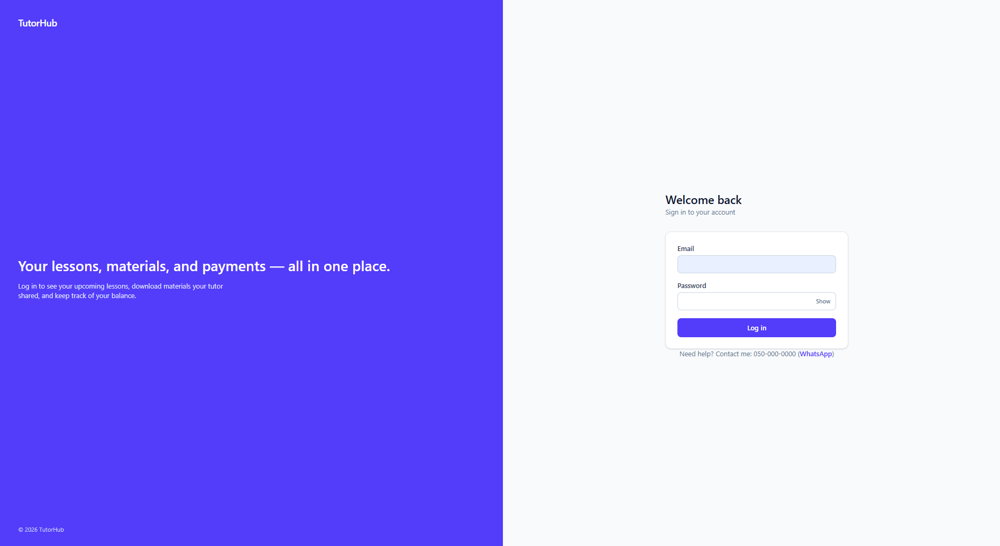
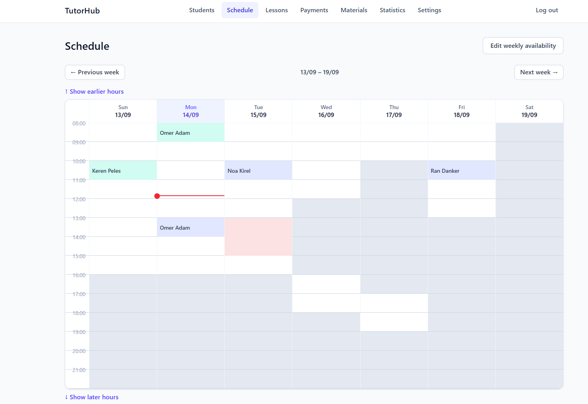
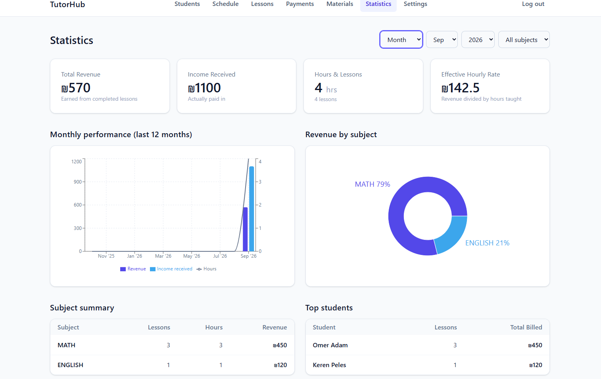

# TutorHub

A full-stack web app for a private tutor to manage students, lesson scheduling, payments, and study materials — built end-to-end as a portfolio project: REST API, relational schema, JWT auth, async messaging, and a React frontend.

**Stack:** Spring Boot 4 (Java 17) · PostgreSQL · Spring Security (JWT) · JMS (embedded ActiveMQ Artemis) · React 19 + TypeScript · Tailwind CSS · Vite

**Infrastructure:** Docker (multi-stage builds) · Docker Compose · nginx · Caddy (automatic HTTPS) · AWS EC2 + S3 · Cloudflare DNS



## Live

**https://omerlessons.com** - the production deployment, used with real students. The screenshots below show the main screens.

## Features

- **Auth** — JWT-based login with two roles (teacher / student). No public sign-up; only the teacher can create student accounts. Login attempts are rate-limited per email to block brute-force attempts.
- **Scheduling** — a weekly grid combining recurring availability rules with one-off overrides (block or open a specific slot). Either the teacher or the student can book a lesson; bookings are protected against double-booking with a database-level lock, not just an application-level check.
- **Lessons** — booking, editing, cancellation (with a minimum-notice window for students), and completion — the trigger that turns a lesson into billable debt. Each lesson snapshots its price at booking time, so a later rate change never rewrites history.
- **Payments** — the teacher records payments per student; outstanding debt is computed from completed lessons minus payments, viewable per-student or as a full list.
- **Study materials** — the teacher shares files, links, or notes with a student, optionally tied to a specific lesson. File uploads are stored as binary data in Postgres.
- **Statistics** — revenue, lesson volume, and debt overview for the teacher, with charts.
- **Email reminders** — an async job scans for upcoming lessons and emails students ahead of time, respecting quiet hours.





## Architecture

**Backend** follows a strict layered structure — `Controller → Service → Repository` — with one hard rule: a service never reaches into another domain's repository directly, it goes through that domain's service. A few packages break the "one folder per layer" pattern on purpose, because they're cross-cutting infrastructure rather than another feature slice:

- `security/` — JWT creation and validation, the request filter that populates the security context on every call, and a per-email login rate limiter.
- `jms/` — the async reminder pipeline: a scheduled producer that queues lesson IDs needing a reminder, and a listener that sends the email and marks it sent (only after a successful send, so a transient failure retries on the next scan instead of silently dropping).
- `exception/` — every domain error carries its own HTTP status, so a single `@RestControllerAdvice` handler maps all of them without a switch statement; framework-level exceptions (bad JSON, oversized uploads, auth failures, optimistic-lock conflicts) each get one explicit handler.
- `config/` — Spring wiring (security filter chain, CORS, initial teacher account seeding).

DTOs (Java records) are strictly separate from JPA entities — nothing entity-shaped crosses the controller boundary, and a couple of DTOs conditionally omit fields depending on who's asking (a student never sees a teacher's private lesson notes, for instance).

**Frontend** mirrors the same layering: pages are thin (layout only), hooks own state and talk to the API (the "service layer"), and components are pure presentation driven by props. A component lives in a feature subfolder only if it's used by exactly one page; anything reused across pages, or generic UI (modal shell, pager, nav), stays at the top level.

**Concurrency & data integrity**

- Two people booking the same slot at once is resolved with a Postgres advisory lock scoped to the transaction and keyed by date — not just an in-memory or optimistic check — so the database itself serializes the conflicting writes.
- `@Version` optimistic locking on lessons and payments returns a clean 409 instead of silently overwriting a concurrent edit.
- Lessons and payments are soft-deleted (status flag) to preserve history for statistics; materials are hard-deleted since there's nothing to retain.


## Running it locally

**With Docker (recommended)** - starts PostgreSQL, the backend and the frontend with one command:

```bash
cp .env.example .env      # fill in the values marked "required"
docker compose up --build
```

Then open `http://localhost:8400` (change the port with `WEB_PORT` in `.env`). The database lives in a Docker volume, so data survives restarts; `docker compose down -v` deletes it.

**Without Docker**

```bash
# backend: needs a PostgreSQL database matching spring.datasource.url
# in src/main/resources/application.properties, plus the values from .env
./mvnw spring-boot:run

# frontend
cd frontend
npm install
npm run dev               # http://localhost:5173, calling the backend at http://localhost:8080
```

Tables are created/updated automatically on startup (`ddl-auto=update`); a teacher account is seeded from the `.env` values on first run.

## Deployment

The production site runs on a single AWS EC2 instance (Ubuntu, `t3.small`) with Docker Compose:

```
browser --HTTPS--> Caddy (80/443, automatic Let's Encrypt certificates)
                     |
                     v
                   nginx (frontend container: serves the React build, forwards /api/ to the backend)
                     |
                     v
                   Spring Boot backend  -->  PostgreSQL (data volume)
```

- **Only ports 80 and 443 are open to the internet.** The backend and the database are reachable only inside the Docker network; SSH is restricted to a single IP and uses a key pair.
- **One entry point.** nginx forwards `/api/` to the backend, so the browser talks to one origin: no CORS setup and no backend port exposed.
- **Multi-stage Docker builds** keep the images small: the build stage has the JDK / Node toolchain, and the final image has only the JRE + the jar (backend) or nginx + static files (frontend).
- **Compose files:** `docker-compose.yml` is the base, `docker-compose.override.yml` is loaded automatically for local development (exposes the site on `WEB_PORT`), and `docker-compose.prod.yml` adds Caddy on the server (selected with `COMPOSE_FILE`).
- **Secrets** (`.env`) live only on the machine, outside git and outside the images, and are passed to the containers as environment variables at runtime. On the server they are generated there with `openssl` and the file is `chmod 600`.
- **Resilience:** containers use `restart: unless-stopped`, and the full stack was verified to come back on its own after a server reboot.
- **Backups:** a nightly cron job runs `pg_dump`, keeps 14 days locally and copies each dump to a private, encrypted S3 bucket. The server writes to S3 through an IAM role limited to that bucket (no access keys on the machine). A restore was tested into a scratch database.
- **Cost alerts:** AWS Budgets send an email when real spend appears or when usage jumps.

To deploy an update: `git pull` and `docker compose up -d --build` on the server.

### Configuration

Configuration comes only from environment variables (see `.env.example`):

| Where | Variable | Purpose |
| --- | --- | --- |
| Backend | `DB_USERNAME`, `DB_PASSWORD` | Postgres credentials (Compose also uses them to create the database) |
| Backend | `DB_URL` | JDBC url; Compose sets it to the `postgres` service |
| Backend | `JWT_SECRET` | signs login tokens |
| Backend | `TEACHER_SEED_EMAIL`, `TEACHER_SEED_PASSWORD` | the teacher account created on first start |
| Backend | `CORS_ALLOWED_ORIGINS` | the frontend's address |
| Backend | `MAIL_USERNAME`, `MAIL_PASSWORD` | Gmail SMTP for lesson reminders |
| Backend | `BREVO_API_KEY`, `BREVO_SENDER_EMAIL` | optional: send email over HTTPS where SMTP is blocked |
| Compose | `WEB_PORT` | local port for the site (default 8400) |
| Server only | `DOMAIN`, `COMPOSE_FILE` | domain Caddy serves, and which Compose files to load |
| Frontend | `VITE_API_URL` | the backend's address at build time (`/api` with the proxy) |
| Frontend | `VITE_CONTACT_PHONE` | optional contact line on the login screen; hidden when unset |
